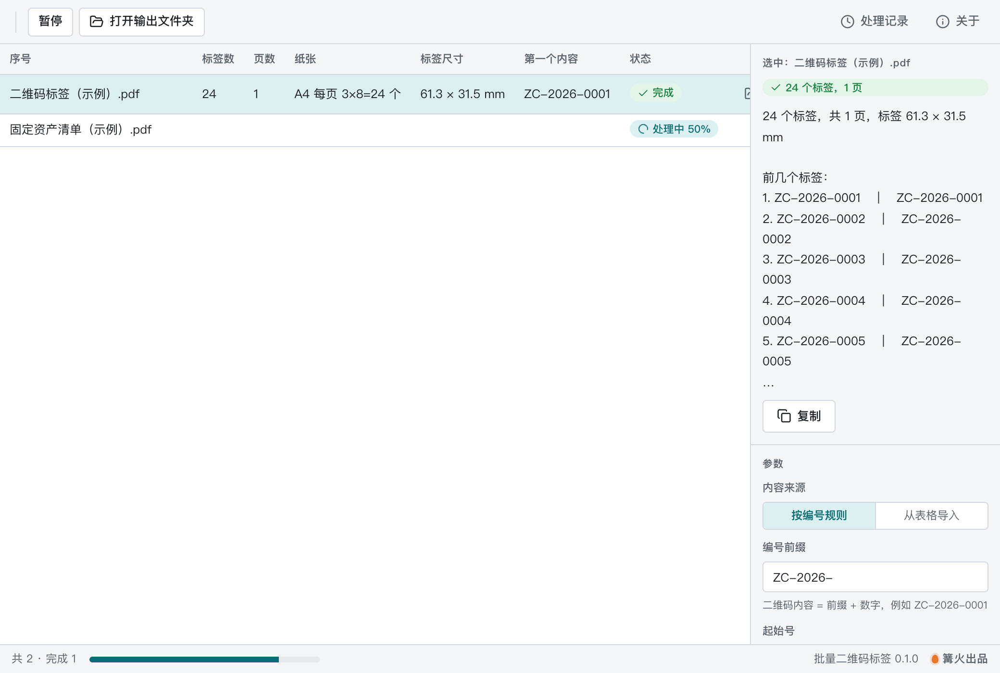

# 批量二维码标签

> 篝火出品 · 收录于篝火 App 应用区

带编号的二维码批量生成，排版成可打印 PDF



## 下载

到 [Releases](https://github.com/campfire-code/batch-qrcode-labels/releases/latest) 下载对应安装包：

| 电脑 | 文件 |
|---|---|
| Windows 10 / 11 | `batch-qrcode-labels_版本号_windows-x64-setup.exe` |
| Mac（Apple 芯片） | `batch-qrcode-labels_版本号_mac-arm64.dmg` |
| Mac（Intel 芯片） | `batch-qrcode-labels_版本号_mac-x64.dmg` |

第一次打开：
- **Windows**：如果弹出「Windows 已保护你的电脑」，点「更多信息」→「仍要运行」。
- **Mac**：如果提示「无法验证开发者」，打开「系统设置 → 隐私与安全性」，在下方点「仍要打开」。

## 怎么用

1. 「内容来源」二选一：
   - **按编号规则**：填前缀、起始号、数量、补零位数，二维码内容 = 前缀 + 数字（例如 `ZC-2026-0001`）。数量最多 10000。
   - **从表格导入**：选 .xlsx 或 .csv（读第一个工作表；CSV 自动识别 UTF-8 / GBK），填二维码内容所在的列（表头名或列字母），「表头在第几行」默认 1。该列为空的行会跳过并在结果里提示。
2. 「标签文字」每行对应标签上的一行字：`{内容}` 是二维码内容，`{序号}` 是第几个，表格可写列名，例如 `{名称}`。留空则只印二维码。
3. 「纸张」选 A4、自定义纸张，或「标签纸」（每页一张标签，页面尺寸就是标签尺寸）。A4 / 自定义时填每页列数行数、边距和间距，标签尺寸自动算出并在结果里显示。
4. 选排版（二维码在左或在上）、内边距、字号、纠错等级（L / M / Q / H）；用普通 A4 纸裁剪时可打开「画出标签边框」。
5. 选「保存到」文件夹，点「生成 PDF」。结果里列出标签数、页数、纸张、标签尺寸，并可打开输出文件夹。

全部在本机完成，不联网、不上传。文字用系统字体画成图片放进 PDF，所以 PDF 里的文字不能选中复制，二维码是矢量图。

## 验收用例

| 操作 | 应得到 |
|---|---|
| 不改任何参数，点「生成 PDF」 | 生成 `二维码标签.pdf`，1 页 A4，24 个标签（3 列 × 8 行），内容 `ZC-2026-0001` 至 `ZC-2026-0024`；结果显示标签尺寸 61.3 × 31.5 mm |
| 数量改为 50 | 3 页（24 + 24 + 2） |
| 来源选「从表格导入」，文件选 `samples/固定资产清单-示例.xlsx`，列填 `编号`，标签文字填 `{名称}`、`{位置} · {内容}` | 30 个标签（表里有 1 行漏填编号，被跳过并提示），每个标签第一行是名称，第二行是位置和编号 |
| 纸张选「标签纸」，标签宽 40、高 30 | 每个标签一页，页面 40 × 30 mm |
| 用手机扫描 PDF 中任一二维码 | 识别出的内容与标签上的编号一致（需自行扫描确认） |

## 自己编译

需要 Node.js 22、pnpm、Rust。

```bash
pnpm install
pnpm test          # 单元测试
pnpm tauri dev     # 开发运行
pnpm tauri build   # 打包
```

界面框架在 `src/kit`（所有 campfire-code 工具共用），本工具的逻辑在 `src/tool`。

## 致谢

本工具基于开源项目 [pdfme/pdfme](https://github.com/pdfme/pdfme)（MIT）。

## 归属

本工具由**篝火**出品，是篝火 App 应用区收录的开源工具之一，由篝火（GitHub 组织 [campfire-code](https://github.com/campfire-code)）维护与更新。全部工具的目录见 [toolkit-hub](https://github.com/campfire-code/toolkit-hub)。

## 许可证

MIT，版权方为篝火（campfire-code）。
